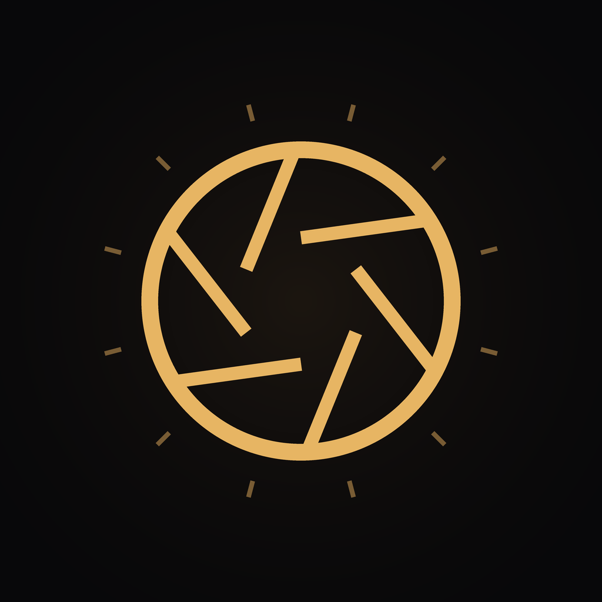

# LUMIÈRE

一款 iOS 专业相机 + 胶片模拟 App 的完整 SwiftUI 工程。七种手调胶片配方、Metal 实时取景、全手动曝光，以及非破坏性调色。



## 运行

1. 双击 `Lumiere.xcodeproj`（需要 **Xcode 16 或更新版本**，工程使用文件系统同步组）。
2. 选中 `Lumiere` target → Signing & Capabilities → 填入你的 Team，Bundle Identifier 改成你自己的（默认 `com.lumiere.camera`）。
3. 连接 **真机** 运行。模拟器没有摄像头，会停在"无法启动相机"提示页。
4. 首次启动需要在系统弹窗中允许「相机」；保存照片时会再请求「添加到相册」。

最低系统版本 iOS 17.0，仅竖屏。

## 功能

| 模块 | 能力 |
| --- | --- |
| 取景 | Metal 实时渲染、aspect-fill 满屏、30fps 胶片滤镜预览 |
| 胶片 | 原片 / Portra 400 / CineStill 800T / Gold 200 / Superia / Velvia 50 / HP5 |
| 手动 | ISO、快门（1/8000–0.5s，对数滑杆）、色温 2000–8000K、一键回 AUTO |
| 对焦 | 点击对焦 + 曝光锁定，带收束动画的对焦框 |
| 变焦 | 0.5× / 1× / 2× / 3× 快捷档位（按设备能力动态显示），双指捏合无损变焦 |
| 构图 | 三分网格、基于陀螺仪的水平仪（±1.2° 内变琥珀色） |
| 拍摄 | 闪光灯关/自动/开、快门白闪 + 触感反馈 |
| 相册 | 应用内胶片库、查看大图、重新套用任意配方、分享、保存到系统相册、删除 |
| 设置 | 保存到相册、前置镜像、网格、水平仪、触感的持久化开关 |

## 工程结构

```
Lumiere/
├── LumiereApp.swift            入口
├── App/RootView.swift          相机权限门控
├── Theme/Theme.swift           设计令牌（暗色 + 琥珀强调色）
├── Camera/
│   ├── CameraService.swift     AVCaptureSession、手动曝光/对焦/白平衡、拍照代理
│   ├── PreviewView.swift       MTKView + Core Image 实时上屏、点击/捏合手势
│   └── MotionLevel.swift       CoreMotion 水平仪
├── Filters/
│   ├── FilmLook.swift          一份配方的数据描述（曲线、光晕、颗粒、暗角）
│   ├── FilmLibrary.swift       七种胶片的参数表
│   ├── FilmEngine.swift        Core Image 渲染管线（预览与导出共用）
│   └── PhotoPipeline.swift     纯函数：解码 → 调色 → 输出 UIImage / JPEG
├── Models/
│   ├── PhotoAsset.swift        照片与 sidecar 元数据
│   └── CaptureStore.swift      文件型胶片库（Documents/Captures）
├── ViewModels/CameraViewModel.swift
├── Views/                      CameraScreen / Gallery / Detail / Settings / 组件
└── Support/                    AppSettings、相册写入、触感
```

## 胶片是怎么做出来的

没有 LUT 图片，全部是参数化调色，因此可以逐帧跑在 GPU 上：

1. **逐通道三次多项式**（`CIColorPolynomial`）：`a·x³ + b·x² + c·x + d`，一次拿到阴影抬升（d）、通道增益（c）、高光滚降（b）。CineStill 的青蓝阴影就是把蓝通道的 d 抬到 0.05、红通道压到 -0.008。
2. **全局对比与饱和**（`CIColorControls`）。
3. **光晕 Halation**（`CIBloom` + `CIColorMatrix` 染色 + `CIScreenBlendMode`）：CineStill 的红色光晕强度 0.42，是它最标志性的一笔。
4. **颗粒**：一张 512×512 的 `CIRandomGenerator` 噪声按输出尺寸缩放，取单通道后以 `CISoftLightBlendMode` 叠加，强度按胶片型号给。
5. **暗角**（`CIVignetteEffect`）。

要加一种新胶片，只需在 `FilmLibrary.swift` 里加一条 `FilmLook`，UI 与渲染管线会自动接管。

## 设计取舍

- **非破坏性**：每次拍摄同时保存原始 JPEG 与 sidecar JSON（只记录 lookID）。在大图页换配方时从原片重渲染，不会叠加两次。
- **预览与成片一致**：预览、缩略图、导出走的是同一个 `FilmEngine`，只是输入分辨率不同。
- **预览降采样**：取景时先把 12MP 帧缩到长边 1440 再调色，屏幕上看不出差别，但省掉大量 GPU 时间。
- **对焦坐标**：点击位置需要从竖向预览换算回传感器坐标系（旋转 90°），`PreviewView.devicePoint(for:)` 里做了这个逆变换；不同机型的前摄朝向可能有 1–2° 偏差。

## 持续集成

仓库已内置两条 GitHub Actions 工作流：

| 文件 | 触发 | 作用 |
| --- | --- | --- |
| `.github/workflows/ios.yml` | push / PR / 手动 | 模拟器编译 + 打未签名 IPA，产物在 Artifacts |
| `.github/workflows/testflight.yml` | 仅手动 | 归档、导出并上传 TestFlight |

`ios.yml` 不需要任何 Secrets。测试 TestFlight 前需要在仓库 Secrets 里配置 `DIST_CERT_P12`、`DIST_CERT_PASSWORD`、`PROVISIONING_PROFILE`、`PROFILE_NAME`、`TEAM_ID`、`KEYCHAIN_PASSWORD`、`ASC_KEY_ID`、`ASC_ISSUER_ID`、`ASC_KEY`，详见该文件头部注释。

## 已知限制

- 模拟器无法取景。
- 前摄镜像只在预览与拍照的取景框内生效，成片方向由系统 EXIF 决定。
- 未实现视频录制、RAW/DNG、景深模式——这些都可以在当前 `CameraService` 上继续挂 `AVCaptureMovieFileOutput` / `AVCapturePhotoOutput.maxPhotoDimensions` 来扩展。
